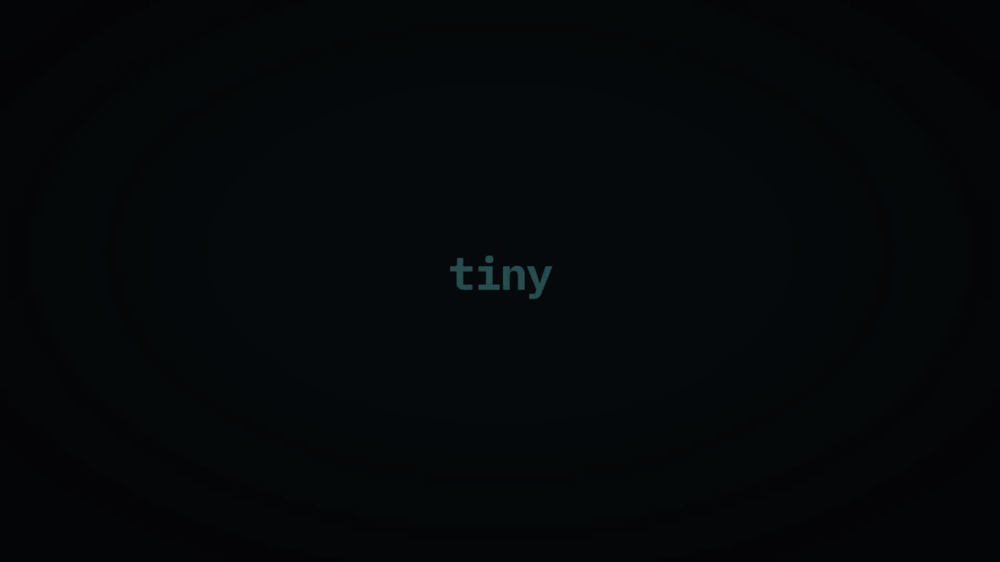

# tiny

tiny reads questions from YAML, asks them in a terminal and returns the answers as JSON, YAML or shell variables. The same file can supply defaults for an unattended script.

Use it for setup scripts, release gates and other commands that need both interactive and automated modes. Your script handles the work; tiny handles the questions and validation.



## Install

With Homebrew on macOS or Linux:

```sh
brew install martino-vigiani/tap/tiny
tiny -version
tiny demo
```

Release binaries do not need Go installed. Other platform archives are on the [releases page](https://github.com/martino-vigiani/tiny/releases).

To build this checkout, use Go 1.25 or newer:

```sh
go build -trimpath -ldflags "-s -w" -o tiny ./cmd/tiny
./tiny -defaults examples/quickstart.yaml
```

An unstamped source build reports version `dev`. Tagged release builds set the version at link time.

## First wizard

Save this as `deploy.yaml`:

```yaml
steps:
  - type: select
    key: environment
    title: Environment
    options: [dev, staging, prod]
    default: staging

  - type: confirm
    key: deploy
    title: Deploy now?
    default: "no"
```

Run it interactively, or resolve the defaults without reading input:

```sh
tiny deploy.yaml
tiny -defaults deploy.yaml
```

The second command returns:

```json
{
  "deploy": false,
  "environment": "staging"
}
```

Prompts go to stderr. Answers go to stdout, so a shell script can capture them or pipe them into `jq`:

```sh
answers="$(tiny deploy.yaml)" || exit 1
environment="$(printf '%s' "$answers" | jq -r '.environment')"
```

`jq` is needed for this shell example, not for tiny itself. Without a terminal or input, unanswered steps fall back to their defaults. Use `-require-tty` when a human answer is required.

## What it supports

- Thirteen step types: `select`, `multiselect`, `confirm`, `input`, `password`, `search`, `autocomplete`, `number`, `date`, `keyvalue`, `editor`, `table` and `file`.
- Input validation, questions conditional on earlier answers, interpolation and reusable spec fragments.
- Pre-seeded answers with `-set` or `-answers`, output formats with `-format`, and theme presets or YAML themes.
- Display commands: `say`, `box`, `bar` and `spin`. `spin` preserves the wrapped command's stdout and exit status.

Global flags come before the spec or subcommand:

```sh
tiny -set environment=prod deploy.yaml
tiny -defaults -format yaml deploy.yaml
tiny -theme sleek demo
tiny spin "Building" -- go build ./...
```

An `editor` step uses an external editor; see its configuration in the spec reference.

## Examples and reference

- [SPEC.md](SPEC.md): schema, step types, flags, conditions, defaults and output contracts.
- [THEMING.md](THEMING.md): presets and custom styles.
- [AGENT-GUIDE.md](AGENT-GUIDE.md): writing and checking wizard files with a coding agent.
- [examples/](examples/): branching, composed and themed wizards.
- [scaffold.sh](examples/scaffold.sh): a script that consumes the answers, including a `--ci` mode. It needs `tiny` and `jq` on `PATH`.
- [CHANGELOG.md](CHANGELOG.md): changes by version.

## Development

The architecture and contribution rules are in [AGENTS.md](AGENTS.md). For a code change, run:

```sh
go build ./...
go vet ./...
go test ./...
gofmt -l .
```

`gofmt -l .` should print no files. The existing tests cover terminal-independent input, default parity, output streams and rendering. Interactive behavior still needs terminal checks when it changes.

[MIT](LICENSE).
