# tiny

**tiny asks the questions your scripts need to ask.**

You have a script — a deploy, a scaffold, a migration. Before it does the work,
it has to ask a human a few things. tiny is the command your script calls to ask
them, and it hands the answers back as JSON.

<p align="center">
  
</p>

<sub>Recorded from the real binary — see <a href="docs/media/record.py"><code>docs/media/record.py</code></a>.</sub>

## Where it sits

tiny is not a framework and does not run your program. It is a command you call
from inside your own script, like `jq` or `curl`:

```
your script  ──calls──▶  tiny  ──reads──▶  deploy.yaml   (the questions)
                          │
                          ├──▶ draws the questions on screen   (for the human)
                          └──▶ prints JSON  ──▶  back to your script
```

## The problem it solves

Here is the same script twice. First, the way everyone writes it:

```sh
# deploy.sh — before
read -p "Environment (dev/staging/prod): " env
case "$env" in dev|staging|prod) ;; *) echo "invalid"; exit 1 ;; esac

read -p "Version (vX.Y.Z): " version
[[ "$version" =~ ^v[0-9]+\.[0-9]+\.[0-9]+$ ]] || { echo "invalid"; exit 1; }

read -p "Deploy now? [y/N] " ok
[ "$ok" = "y" ] || exit 1

# ...and now CI, where nobody is there to answer:
if [ "$1" = "--yes" ]; then
  env=staging          # every default, written a second time
  version="v0.0.0"     # and kept in sync by hand, forever
  ok=y
fi
```

The questions are code. You cannot read them without running them, and the
unattended path is a copy of the defaults that drifts the first time somebody
edits one and forgets the other.

Now the same thing with tiny. The questions move into a file:

```yaml
# deploy.yaml
steps:
  - type: select
    key: env
    title: "Environment"
    options: [dev, staging, prod]
    default: staging

  - type: input
    key: version
    title: "Version"
    default: "v0.0.0"
    pattern: "^v[0-9]+\\.[0-9]+\\.[0-9]+$"
    message: "Use vX.Y.Z."

  - type: confirm
    key: deploy
    title: "Deploy now?"
    default: "no"
```

and the script becomes three lines:

```sh
# deploy.sh — after
answers="$(tiny deploy.yaml)" || exit 1

env="$(jq -r .env         <<<"$answers")"
version="$(jq -r .version <<<"$answers")"
[ "$(jq -r .deploy <<<"$answers")" = true ] || exit 1
```

The validation, the re-prompting, the arrow keys and the filtering come with the
file. And the unattended path is no longer a second copy of anything:

```sh
tiny -defaults deploy.yaml      # in CI: no terminal, no questions, same answers
```

**One file, two modes.** That is the whole idea. A human answers it; CI runs the
same file and gets the same shape of JSON, with no second code path to keep in
sync.

## When to use it, and when not

**Use it** when a script has to ask a human something *and* has to run
unattended somewhere else — CI, a cron job, a git hook, a teammate's machine.

**Don't** when there is nothing to ask, or when you are building a full-screen
application with panes and streaming output. tiny asks a question and exits; it
is a piece of your script, not the thing that owns the screen.

## Install

```sh
go install github.com/martino-vigiani/tiny/cmd/tiny@latest
```

Or from source:

```sh
git clone https://github.com/martino-vigiani/tiny
cd tiny && go build -trimpath -ldflags "-s -w" -o tiny ./cmd/tiny
```

There is no tagged release yet, so both commands compile it locally.

Then, to see everything it can do without writing a file:

```sh
tiny demo
```

## Try it in thirty seconds

No file needed — pipe the questions straight in:

```sh
tiny - <<'YAML'
steps:
  - {type: select, key: env, title: "Environment", options: [dev, staging, prod], default: staging}
  - {type: confirm, key: go, title: "Deploy now?", default: "no"}
YAML
```

The questions are drawn on stderr and the JSON goes to stdout, so you can pipe
the payload into `jq` while somebody is still answering the questions on screen.

A complete working script — spec, run, `jq`, act on the answers, plus a `--ci`
mode — is [`examples/scaffold.sh`](examples/scaffold.sh):

```sh
./examples/scaffold.sh          # interactive
./examples/scaffold.sh --ci     # unattended, same file
```

<p align="center">
  
</p>

## What you can ask

Thirteen kinds of question: `select`, `multiselect`, `confirm`, `input`,
`password`, `search`, `autocomplete`, `number`, `date`, `keyvalue`, `editor`,
`table`, `file`.

A question can be asked only when an earlier answer calls for it:

```yaml
  - type: input
    key: ticket
    title: "Change ticket"
    when: "env == prod"        # not asked for dev or staging
```

Answers can be validated (`pattern`, `min_length`), interpolated into later
questions (`${version}`), pre-seeded from the command line (`-set env=prod`),
and restyled to match your own tool (`-theme`). All of it is in
**[SPEC.md](SPEC.md)**.

## It also draws

Four commands show something instead of asking. They exist because a script
that asks well should not then go silent while it works:

```sh
tiny spin "Building…" -- go build ./...   # spinner while a command runs
tiny say "Deploy complete" --style header # one styled line
tiny box "Plan" < plan.md                 # a bordered box
tiny bar 3 12 "files"                     # a progress line, redrawn in place
```

<p align="center">
  
</p>

`tiny spin` exits with its child's exit code and lets the child's stdout through
untouched, so it is safe to drop into a pipeline. Without a terminal all four
degrade to one plain line with no escape sequences — a CI log full of spinner
frames is why people turn spinners off.

## With a coding agent

An agent cannot answer a prompt for you: its shell usually has no terminal at
all. What it can do is **write** the interaction — generate `deploy.yaml`, wire
it into your Makefile, and check that it resolves with `tiny -defaults` — all
without a terminal, because the interaction is a file rather than code that has
to be run to be read.

**[AGENT-GUIDE.md](AGENT-GUIDE.md)** is the page to hand it: the TTY check, a
block to paste into `CLAUDE.md` or `AGENTS.md`, and the mistakes to avoid.

## What it costs

Measured on this repository, not claimed:

- **3.0 MB** binary (`go build -trimpath -ldflags "-s -w"`).
- **2 direct dependencies** — `golang.org/x/term` and `gopkg.in/yaml.v3`.
- **5.8 MiB** peak resident memory, CPU time too small to register
  (`/usr/bin/time -l tiny -defaults examples/quickstart.yaml`).
- **342 tests**, all green (`go test -race ./...`).

## Compared to gum

[gum](https://github.com/charmbracelet/gum) does the styled-prompt part of this
well, and more of the general-purpose styling. The difference that matters here:
gum has no spec file and no headless mode. The questions stay inside your shell
script, so the unattended path is still yours to write and keep in sync.

## Reference

- **[SPEC.md](SPEC.md)** — every step type, every flag, conditions, `include:`,
  `-paths`, `-meta`.
- **[THEMING.md](THEMING.md)** — making it look like your own tool.
- **[AGENT-GUIDE.md](AGENT-GUIDE.md)** — using it from a coding agent.
- **[AGENTS.md](AGENTS.md)** — architecture and how to contribute.
- `tiny -h` — every flag, in the terminal.

```sh
go build ./... && go vet ./... && go test ./... && gofmt -l .
```

## License

MIT.
